<div align="center">

# Downstream

### Causal discovery on real river networks: a benchmark audit and a first-principles rethink

[](#reproduce)
[](https://colab.research.google.com/github/Mathindata/causal-rivers-lab/blob/main/notebooks/01_eda_causal_lens.ipynb)
[](LICENSE)


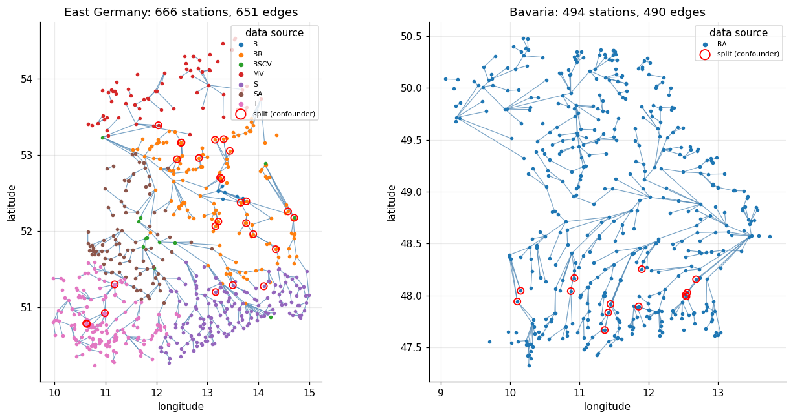

*1,160 gauging stations, 5 years of 15-minute discharge, and a ground-truth causal graph taken from the river network itself.*

</div>

---

## In short

Can a causal discovery algorithm find which river flows into which, using only the discharge time series? The [CausalRivers](https://github.com/CausalRivers/causalrivers) benchmark (Stein et al., ICLR 2025) makes this testable at scale. This project runs **26 classical methods in 9 families** on it, explains each one from its mathematical basis, and checks what the scores really measure.

**Main findings so far**

1. **The strongest classical baseline in the paper is largely a size shortcut.** VAR reaches AUROC 0.77 on raw discharge but only 0.59 on standardized data. On raw data it points pairs from the smaller to the larger river 87% of the time, whether or not they are connected. This follows from one line of algebra: the ratio of regression coefficients in the two directions equals the ratio of variances, and rivers grow downstream. The paper's own grid agrees: the best VAR run is unnormalized on 91% of sets.
2. **Detection, not orientation, is the real bottleneck.** Deciding *which way* water flows is fairly easy (up to 0.79 from time lags alone). Deciding *whether* two stations are connected tops out at about 0.72 for every method, because rain acts as a hidden common cause.
3. **Pure topography beats every algorithm.** Ordering stations by elevation from the metadata, without looking at the time series, scores 0.80 AUROC. That is above every data-driven method here, and matches or beats the paper's best reported method on 7 of its 10 sets.
4. **The released "confounder" sets test an observed confounder, not a hidden one.** The paper describes removing the common parent, but the released sampling code keeps it. We add a `confounder_hidden` set that removes it.
5. **The data-only top group is a statistical tie** at 0.70 to 0.73 AUROC: PCMCI on rank-transformed data, pairwise and conditional Granger, and lagged cross-correlation.

<p align="center">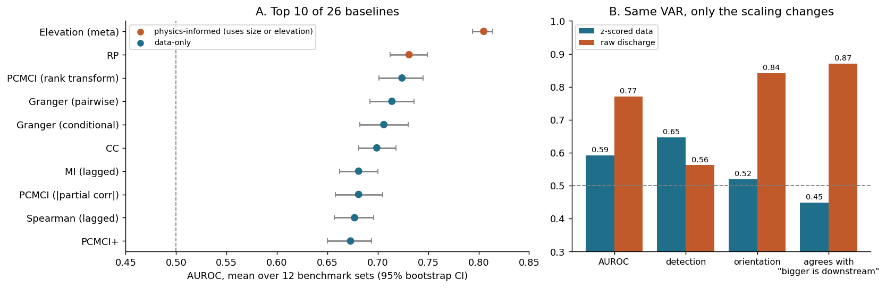</p>

---

## Contents

1. [The dataset](#1-the-dataset)
2. [What makes the problem hard](#2-what-makes-the-problem-hard)
3. [The baselines: 26 methods in 9 families](#3-the-baselines-26-methods-in-9-families)
4. [How we evaluate](#4-how-we-evaluate)
5. [Results](#5-results)
6. [Audit of the benchmark](#6-audit-of-the-benchmark)
7. [Roadmap](#7-roadmap)
8. [Notebooks](#8-notebooks)
9. [Reproduce](#reproduce)
10. [Repository layout](#repository-layout)
11. [References](#references)

---

## 1. The dataset

**CausalRivers** (Stein, Shadaydeh, Blunk, Penzel, Denzler; ICLR 2025) is the largest real-world benchmark for causal discovery on time series.

| | RiversEastGermany | RiversBavaria | RiversFlood |
|---|---|---|---|
| stations (variables) | 666 | 494 | 42 |
| true edges | 651 | 490 | from the Elbe 2024 flood |
| period | 2019 to 2023 | 2019 to 2023 | flood event |
| resolution | 15 min | 15 min | 15 min |

- **Variables:** river discharge (m³/s) at gauging stations.
- **Ground truth:** station A → station B if water measured at A flows *directly* to B, with no other measured station in between. The graph comes from river geography, not from any statistical assumption, so it is an unusually clean causal ground truth.
- **Task:** given the time series of a small set of stations (3 or 5), recover the directed **summary graph**: is there an edge A → B at any lag? Self-loops are ignored.
- **Benchmark sets:** the official code samples subgraphs of several kinds.

| set | what it contains |
|---|---|
| `close` | connected stations that are near each other |
| `root_cause` | a single chain a → b → c … |
| `1_random` | a connected subgraph plus one unconnected station |
| `random` | any connected subgraph |
| `confounder` | contains a split node, i.e. one parent with two measured children |
| `confounder_hidden` | ours: the same, with the parent removed |

The official configuration uses Bavaria as the training graph and East Germany as the test graph. We follow that split.

---

## 2. What makes the problem hard

Notebook 01 examines the data from a causal point of view before running any algorithm. Each finding points to a specific risk for causal discovery methods.

### A flood wave, and why the signal is sparse

<p align="center">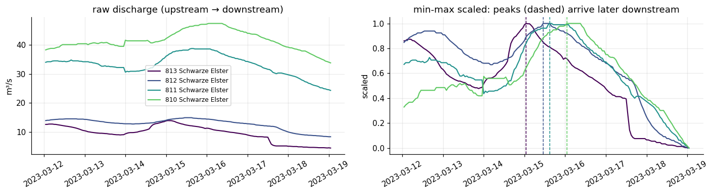</p>

A flood wave moves down the Schwarze Elster: peaks arrive later downstream and grow as tributaries join. The causal signal is clearest during events like this one. Between events, flow is slow and smooth, and says little about direction.

### Rain is a hidden common cause

<p align="center">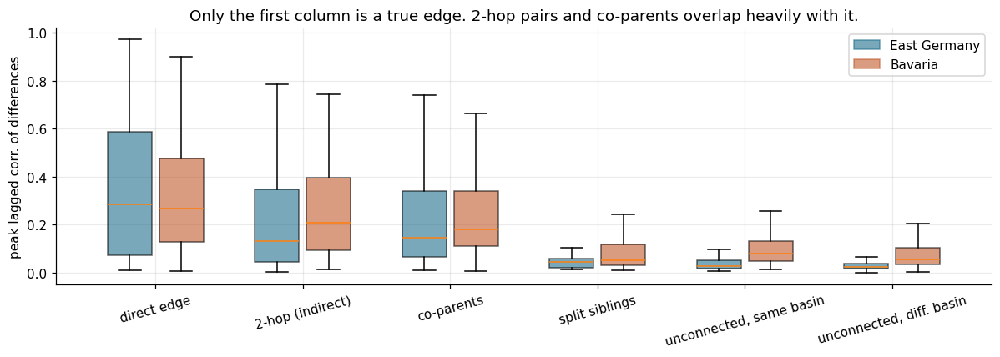</p>

Only the first column is a true edge. Two tributaries that join ("co-parents") are not causally linked, yet their dependence overlaps heavily with true edges, because the same storm hits both. Indirect pairs (A → B → C) are dependent too. **This is why detection is hard.**

### Time resolution changes the question

<p align="center">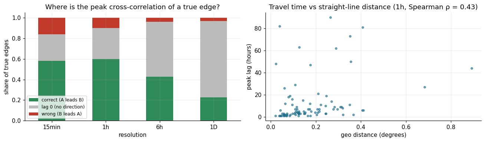</p>

At 15 minutes, a lag between cause and effect is visible but noisy. At daily resolution, 74% of true edges peak at lag 0, so "cause comes before effect" can no longer tell the direction. Straight-line distance only partly predicts travel time (rank correlation about 0.43).

### The full list

| property | evidence | risk for methods |
|---|---|---|
| Graph is almost a tree: about 90% of stations have one downstream neighbour | graph statistics | generic methods ignore a very strong prior |
| Rain = hidden common cause | co-parent dependence | false edges between tributaries |
| Indirect paths A → B → C | 2-hop dependence | pairwise methods add shortcut edges |
| Many effects are instantaneous at coarse resolution | lag analysis | lag-only methods lose edges |
| Travel times range from minutes to days | lag analysis | one global max lag fits few edges |
| Heavy tails: excess kurtosis of hourly changes in the hundreds | distribution checks | Gaussian tests are mis-specified |
| Step-like series: 91% of 15-min changes are exactly zero (median station, East Germany) | step analysis | real resolution is coarser than it looks; ties break rank tests |
| Nonstationary: edge strength switches on in wet winters and off in dry summers | rolling correlation | averaging over regimes |
| Negative discharges in Baltic lowland rivers (backwater) | data profile | local flow reversal, label noise |
| **Size shortcut:** the downstream station has the larger mean flow on 89 to 95% of true edges; elevation orders 95 to 99.8% correctly | shortcut analysis | a method can orient edges without any causal reasoning |

<details>
<summary><b>More figures from notebook 01</b></summary>

<p align="center">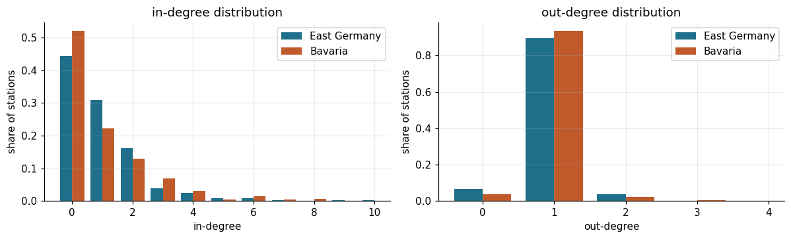</p>
<p align="center">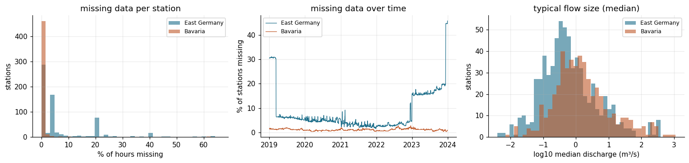</p>
<p align="center">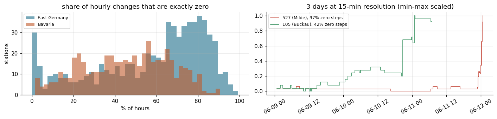</p>
<p align="center">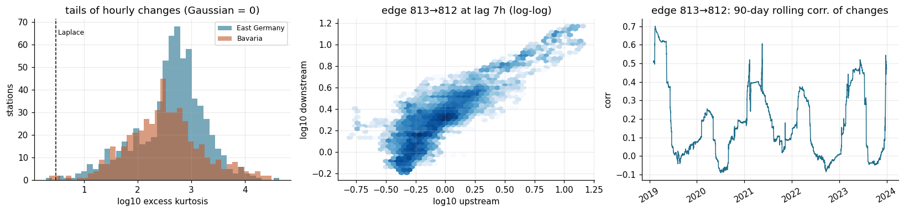</p>
<p align="center">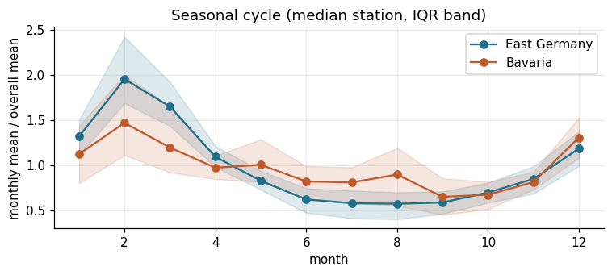</p>

A small note for users of the data: in the metadata files, column `X` is latitude and `Y` is longitude (the dataset README says the reverse).
</details>

---

## 3. The baselines: 26 methods in 9 families

Every method returns a score matrix $S$, where $S_{ij}$ is the evidence for the edge $i \to j$. Nothing is thresholded. All methods see the same data: 6-hour means, linear interpolation, maximum lag $K = 3$ steps (18 hours). Methods that need standardized data z-score it themselves. Notebook 02a gives the full mathematical background of each method before its code.

| family | core idea | methods |
|---|---|---|
| **A · Reference** | rules or chance, no causal model | Random; **Reverse Physical (RP)**: $i \to j$ if $\bar x_j > \bar x_i$; RP + Next: each station's only child is the next larger river; Elevation order (metadata) |
| **B · Association** | dependence between pairs | Pearson $\lvert\rho\rvert$; lagged cross-correlation $\max_{L\ge1}\operatorname{corr}(x^i_t, x^j_{t+L})$; lagged Spearman; lagged mutual information $I(X;Y)=H(X)+H(Y)-H(X,Y)$ |
| **C · Granger / prediction** | a cause improves prediction of its effect | pairwise Granger $F$-test; VAR $\mathbf{x}_t=\sum_k A_k\mathbf{x}_{t-k}+\varepsilon_t$; conditional Granger; Lasso-VAR; nonlinear Granger (gradient boosting with permutation importance) |
| **D · Information theory** | Granger without a model | transfer entropy $T_{X\to Y}=I(Y_t;X_{t-L}\mid Y_{t-1})$ |
| **E · Constraint-based** | read the graph from conditional independences | PCMCI (two scorings), PCMCI on rank-transformed data, PCMCI+ (instantaneous links), LPCMCI (latent confounders) |
| **F · Noise-based (LiNGAM)** | non-Gaussian noise makes direction identifiable | DirectLiNGAM; VARLiNGAM $\mathbf{x}_t=\sum_{\tau\ge0}B_\tau\mathbf{x}_{t-\tau}+\mathbf{e}_t$ (two variants) |
| **G · Score-based** | sparse acyclic fit by continuous optimization | NOTEARS with $h(W)=\operatorname{tr}(e^{W\circ W})-d=0$; DYNOTEARS (both implemented from scratch) |
| **H · Dynamical systems** | Takens embedding and cross mapping | convergent cross mapping (CCM) |
| **I · Deep and learned** | neural Granger and causal pretraining | CDMI, CP (numbers reported from the paper; they need GPUs) |

<details>
<summary><b>What each method looks like on one sample</b></summary>

Each panel is a score matrix (rows = cause, columns = effect) for the same 5-station subgraph, next to the truth.

<p align="center">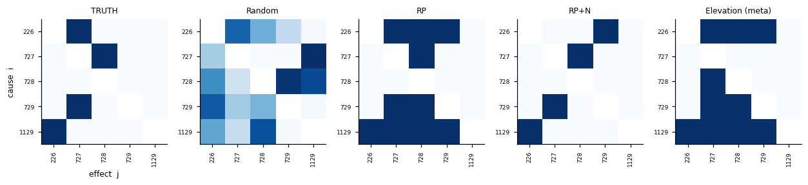</p>
<p align="center">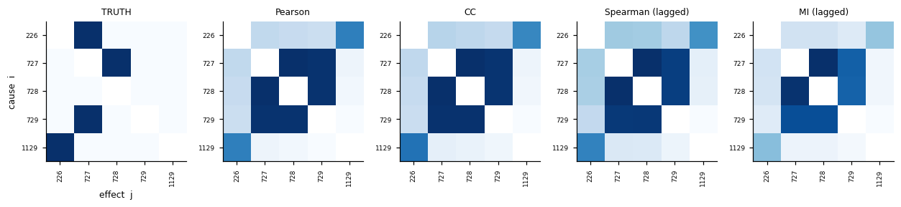</p>
<p align="center">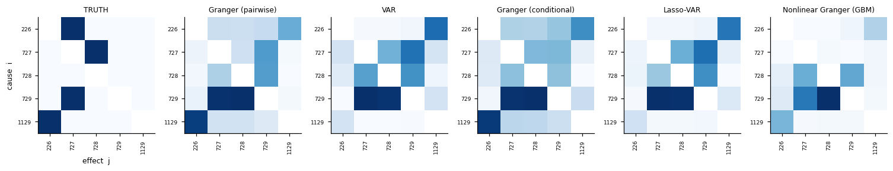</p>
<p align="center">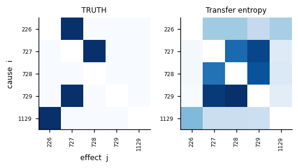</p>
<p align="center">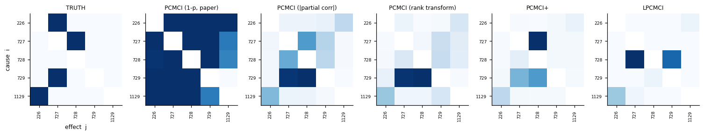</p>
<p align="center">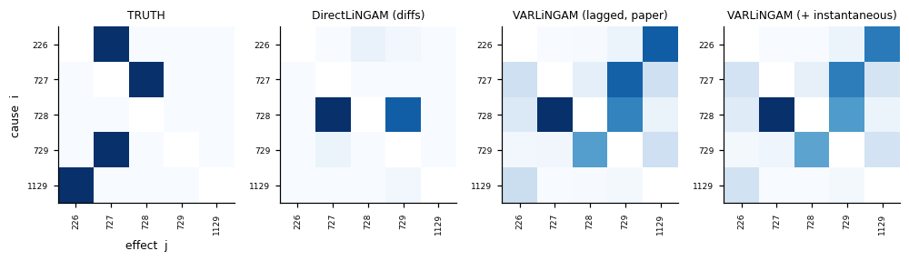</p>
<p align="center">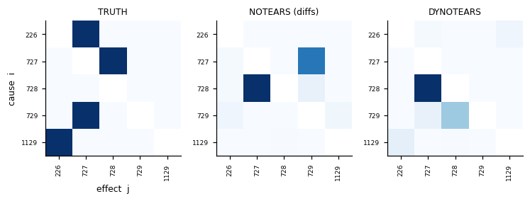</p>
<p align="center">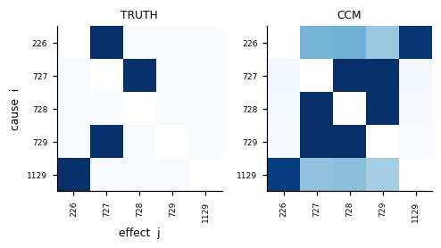</p>
</details>

---

## 4. How we evaluate

- **AUROC** (headline, as in the paper): the probability that a random true edge scores higher than a random non-edge. 0.5 is chance. We use the paper's version: AUROC per sample, averaged over samples. Our number matches the official scorer exactly.
- **Skeleton AUROC** (ours): ignores direction. It measures **detection**: did the method find the right pairs?
- **Orientation accuracy** (ours): over true edges, the share pointed the right way. It measures **direction**.
- **Agreement with RP** (ours): over all pairs, how often a method's preferred direction matches "the bigger river is downstream". This detects the size shortcut.
- **Confidence intervals:** 2,000 bootstrap resamples of the samples in each set.
- **Sample size:** 30 samples per set, over 12 sets (354 subgraphs), with the same samples for every method.

---

## 5. Results

### Ranking

<p align="center">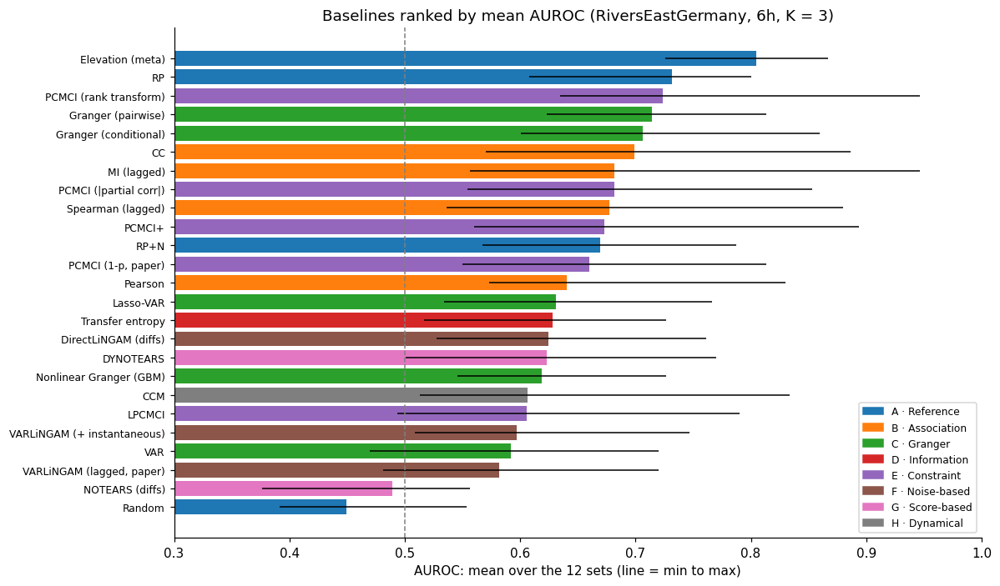</p>

| rank | method | family | AUROC (95% CI) | detection | orientation |
|---|---|---|---|---|---|
| 1 | Elevation order (metadata) | A | 0.805 (0.794 to 0.814) | 0.50 | 0.96 |
| 2 | Reverse Physical (RP) | A | 0.731 (0.712 to 0.749) | 0.50 | 0.85 |
| 3 | PCMCI, rank transform | E | 0.724 (0.701 to 0.745) | 0.65 | 0.78 |
| 4 | Granger, pairwise | C | 0.714 (0.692 to 0.736) | 0.64 | 0.76 |
| 5 | Granger, conditional | C | 0.706 (0.682 to 0.730) | 0.67 | 0.73 |
| 6 | Lagged cross-correlation | B | 0.699 (0.681 to 0.718) | 0.71 | 0.79 |
| … | … | | | | |
| 22 | VAR (z-scored) | C | 0.592 (0.568 to 0.616) | 0.65 | 0.52 |
| 24 | NOTEARS | G | 0.489 (0.460 to 0.518) | 0.66 | 0.48 |
| 25 | Random | A | 0.485 (0.460 to 0.511) | 0.50 | 0.49 |

Full tables are in [`results/`](results).

### Detection vs orientation

<p align="center">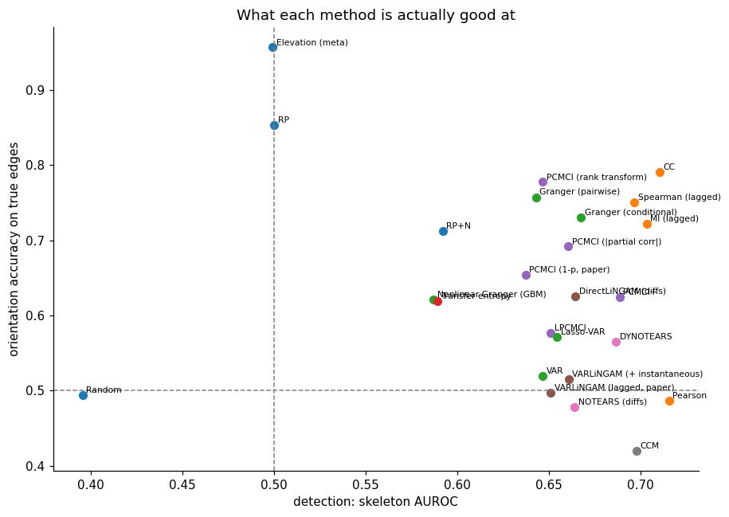</p>

No method gets past about 0.72 on detection, and plain Pearson correlation (0.72) detects as well as methods that condition on other stations. The data-only methods that rank highest do so through orientation from time lags.

### Uncertainty

<p align="center">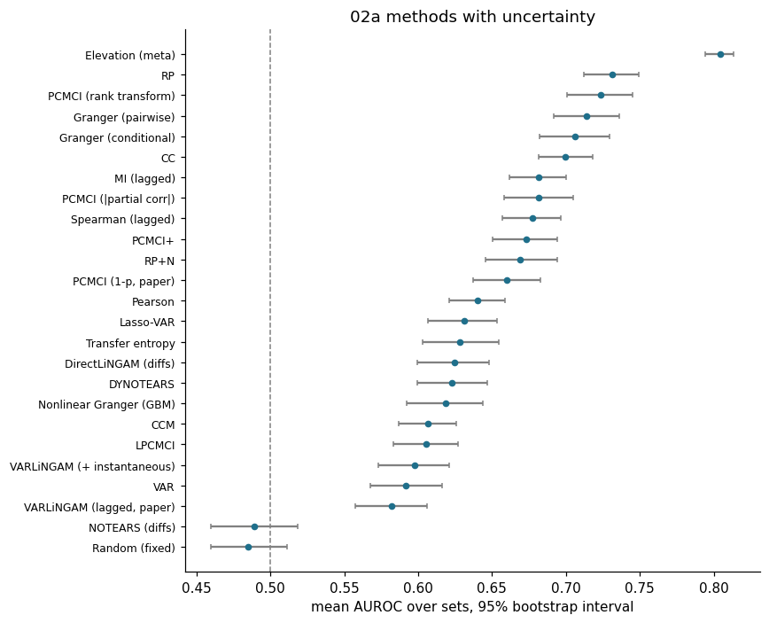</p>

With 30 samples per set, intervals are about ±0.02. The top data-only methods overlap, so they cannot be ranked yet. Notebook 03 will use 100 samples per set.

### Comparison with the paper

Where we run the same method as the paper, results mostly agree set by set: RP, RP + Next and PCMCI are within about ±0.06 on every set. Cross-correlation agrees on most sets and does better here on the `1_random` sets. The paper reports each method at its best hyperparameters, chosen with the test labels; we use one fixed setting. The big exception was VAR and VARLiNGAM, which led to the audit below.

---

## 6. Audit of the benchmark

### 6.1 The VAR size shortcut

For two stations and one regression in each direction, ordinary least squares gives

$$\hat\beta_{y\mid x}=\rho\,\frac{\sigma_y}{\sigma_x},\qquad \hat\beta_{x\mid y}=\rho\,\frac{\sigma_x}{\sigma_y}\qquad\Longrightarrow\qquad \frac{|\hat\beta_{y\mid x}|}{|\hat\beta_{x\mid y}|}=\frac{\sigma_y^2}{\sigma_x^2}.$$

So a coefficient-based score always points from the lower-variance series to the higher-variance one. In rivers, variance grows with flow and flow grows downstream. On raw data, "large coefficient" therefore mostly means "bigger river". This is the time-series form of *varsortability* (Reisach et al., 2021).

| VAR, mean over 12 sets | raw | min-max | z-score |
|---|---|---|---|
| AUROC | **0.77** | 0.63 | 0.59 |
| detection | 0.56 | 0.64 | 0.65 |
| orientation | **0.84** | 0.58 | 0.52 |
| agreement with "bigger is downstream" | **0.87** | 0.49 | 0.45 |

The control confirms the mechanism. The conditional Granger $F$ statistic is scale-invariant and gives exactly 0.706 under all three scalings. VARLiNGAM behaves like VAR.

<p align="center">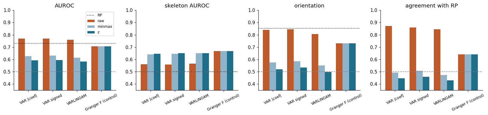</p>

The authors' released hyperparameter grid shows the same pattern. The best VAR run is unnormalized on 91% of sets, and the best VARLiNGAM run on 100%. Averaged over the grid, VAR scores 0.75 unnormalized and 0.63 normalized.

<p align="center">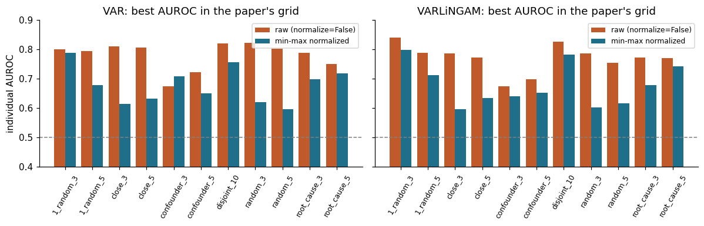</p>

**Consequence:** methods run on unnormalized discharge should be reported as *physics-informed*, not as data-only causal discovery.

### 6.2 The confounder sets

The paper describes the confounder sets as subgraphs where the common parent of two stations is removed, making it hidden. In the released sampling code the parent stays in the sample, and the set sizes the paper reports (24 and 361) match that code. So `confounder` tests an *observed* common cause. Our `confounder_hidden` sets remove the parent, and most methods score lower on them.

### 6.3 Smaller points

- The paper scores PCMCI by $1-p$. With about 7,300 time points, many $p$-values are essentially zero and tie. The partial-correlation effect size ranks slightly better (0.68 vs 0.66).
- DYNOTEARS scores near chance in the paper (about 0.50 to 0.61). Our from-scratch version scores 0.62, which suggests the library setup, not only the method, played a role.

### Two tracks from now on

| track | allowed inputs | best so far |
|---|---|---|
| **Data-only** | standardized time series only | about 0.72 (PCMCI rank, Granger, CC; tied) |
| **Physics-informed** | may use flow magnitude or metadata, declared openly | 0.80 (elevation), 0.77 (raw VAR) |

Every new method is compared within its own track.

---

## 7. Roadmap

- [x] **01 · EDA from a causal perspective:** what the ground truth means, and what makes the problem hard
- [x] **02a · Baselines:** 26 methods, 9 families, math for each, 12 benchmark sets
- [x] **02b · Audit:** the size shortcut, confidence intervals, Random baseline fix
- [ ] **03 · Fair tuning:** tune on Bavaria, test once on East Germany, 100 samples per set, both tracks
- [ ] **04 · New method: detect, orient, then enforce the tree.** Score $S_{ij}=D_{ij}\cdot O_{ij}$, with:
  - $D$: a detection score aimed at rain confounding and indirect paths (rank-based, event-weighted, instantaneous links allowed)
  - $O$: an orientation score from lag asymmetry
  - a tree constraint: each station has at most one downstream neighbour, solved exactly as a maximum-weight arborescence (Chu-Liu/Edmonds)
- [ ] **05 · Deep baselines** (CDMI, causal pretraining) on GPU
- [ ] **arXiv paper:** audit, detection/orientation decomposition, new method
- [ ] **Course notes:** a hands-on introduction to causal inference, built from notebooks 01 and 02

---

## 8. Notebooks

The executed notebooks contain all outputs and figures, which makes them large (0.3 to 1.2 MB). If GitHub fails to render one, use the nbviewer link.

| notebook | content | view | run | runtime |
|---|---|---|---|---|
| `01_eda_causal_lens` | dataset and causal properties | [nbviewer](https://nbviewer.org/github/Mathindata/causal-rivers-lab/blob/main/notebooks/01_eda_causal_lens.ipynb) | [Colab](https://colab.research.google.com/github/Mathindata/causal-rivers-lab/blob/main/notebooks/01_eda_causal_lens.ipynb) | about 5 min |
| `02a_baselines_executed` | 26 baselines with math, full benchmark | [nbviewer](https://nbviewer.org/github/Mathindata/causal-rivers-lab/blob/main/notebooks/02a_baselines_executed.ipynb) | [Colab](https://colab.research.google.com/github/Mathindata/causal-rivers-lab/blob/main/notebooks/02a_baselines_executed.ipynb) | about 80 min (resumable) |
| `02b_shortcut_test` | size-shortcut audit, confidence intervals | [nbviewer](https://nbviewer.org/github/Mathindata/causal-rivers-lab/blob/main/notebooks/02b_shortcut_test.ipynb) | [Colab](https://colab.research.google.com/github/Mathindata/causal-rivers-lab/blob/main/notebooks/02b_shortcut_test.ipynb) | about 5 min |

---

## Reproduce

**Colab (recommended).** Open a notebook with the Colab link and run all cells. The first cell does the rest:

- installs `tigramite`, `lingam` and `hydra-core`;
- clones the official CausalRivers code;
- downloads the data (about 130 MB, 1.1 GB unzipped);
- generates the official benchmark samples.

From 02b on, the notebooks store everything in `MyDrive/causalrivers_project` on Google Drive, so work survives between sessions.

**Local.**

```bash
git clone https://github.com/Mathindata/causal-rivers-lab.git
cd causal-rivers-lab
pip install -r requirements.txt
jupyter lab notebooks/
```

About 3 GB of RAM is enough. Long runs save results per benchmark set and resume where they stopped. Two environment variables control the benchmark size: `N_PER_SET` (samples per set) and `N_JOBS` (parallel workers).

---

## Repository layout

```
causal-rivers-lab/
├── README.md
├── notebooks/            executed notebooks (01, 02a, 02b)
├── src/                  method implementations (m02_methods.py)
├── tools/                scripts that generate the notebooks
├── results/              result tables (CSV)
├── docs/
│   ├── images/           figures used in this README
│   └── HANDOFF.md        project log: settings, findings, next steps
├── requirements.txt
└── LICENSE
```

Data, caches and prediction files (`*.pkl`, `*.parquet`) are not stored in the repository. The notebooks download and rebuild them.

---

## References

Only author, year and venue are listed here; check full details before citing.

- Stein, Shadaydeh, Blunk, Penzel, Denzler (2025). *CausalRivers: Scaling up benchmarking of causal discovery for real-world time-series.* ICLR 2025. [Code and data](https://github.com/CausalRivers/causalrivers)
- Granger (1969). Granger causality. *Econometrica*.
- Schreiber (2000). Transfer entropy. *Physical Review Letters*.
- Shimizu et al. (2006). LiNGAM. *Journal of Machine Learning Research*.
- Hyvärinen et al. (2010). VARLiNGAM. *Journal of Machine Learning Research*.
- Sugihara et al. (2012). Convergent cross mapping. *Science*.
- Zheng et al. (2018). NOTEARS. *NeurIPS*.
- Runge et al. (2019). PCMCI. *Science Advances*.
- Runge (2020). PCMCI+. *UAI*.
- Gerhardus and Runge (2020). LPCMCI. *NeurIPS*.
- Pamfil et al. (2020). DYNOTEARS. *AISTATS*.
- Reisach, Seiler, Weichwald (2021). Varsortability in simulated DAG benchmarks. *NeurIPS*.

All data and the ground-truth graphs come from the CausalRivers project. See their repository for terms of use. This repository contains only code, figures and result tables.

---

<div align="center">
<sub>Matin · <a href="https://github.com/Mathindata">github.com/Mathindata</a> · work in progress, feedback welcome</sub>
</div>
